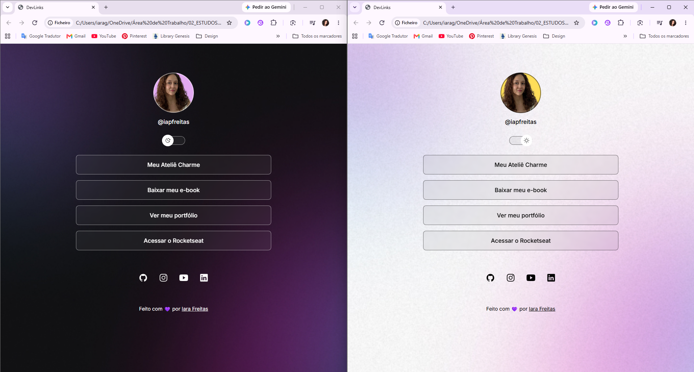

<h1 align="center">IaraLinks</h1>

<p align="center">
  Agregador de links pessoal com alternância entre tema claro e escuro, desenvolvido para centralizar projetos, redes sociais e links profissionais.
</p>

<p align="center">
  <a href="#tecnologias">Tecnologias</a>&nbsp;&nbsp;&nbsp;|&nbsp;&nbsp;&nbsp;
  <a href="#projeto">Projeto</a>&nbsp;&nbsp;&nbsp;|&nbsp;&nbsp;&nbsp;
  <a href="#funcionalidades">Funcionalidades</a>&nbsp;&nbsp;&nbsp;|&nbsp;&nbsp;&nbsp;
  <a href="#estrutura-de-pastas">Estrutura</a>
</p>

<br>

<p align="center">
  
</p>

## Tecnologias

Este projeto foi desenvolvido com as seguintes tecnologias:

- **HTML5**: Estruturação semântica da página.
- **CSS3**: Estilização com variáveis CSS (`:root`), Flexbox, efeitos de transparência (`backdrop-filter`) e transição de temas.
- **JavaScript**: Manipulação do DOM para alternância dinâmica entre os modos *Light* e *Dark* e troca de avatar.
- **Ionicons**: Biblioteca de ícones para as redes sociais.
- **Google Fonts**: Tipografia utilizando a fonte *Inter*.

## Projeto

O **IaraLinks** é um cartão de visitas online responsivo e interativo. Ele reúne links importantes — como portfólio, redes sociais e projetos autorais (como o *Ateliê Charme*) — em uma interface limpa e moderna.

Este projeto foi desenvolvido como parte dos estudos de **HTML e CSS da Rocketseat**, aplicando conceitos de variáveis CSS, posicionamento e manipulação básica de eventos com JavaScript.

## Funcionalidades

- **Alternância de Tema (Light/Dark Mode)**: Botão interativo que altera as variáveis de cores, plano de fundo e a imagem de perfil automaticamente.
- **Links Personalizados**: Botões com efeito *hover* suave e bordas translúcidas.
- **Design Responsivo**: Adaptado para visualização em dispositivos móveis e desktops.

## Estrutura de Pastas

```bash
├── assets/          # Imagens de perfil, planos de fundo e ícones SVG do switch
├── index.html       # Estrutura principal da página
├── style.css        # Estilização e variáveis de tema (Light/Dark)
└── script.js        # Lógica de alternância de tema